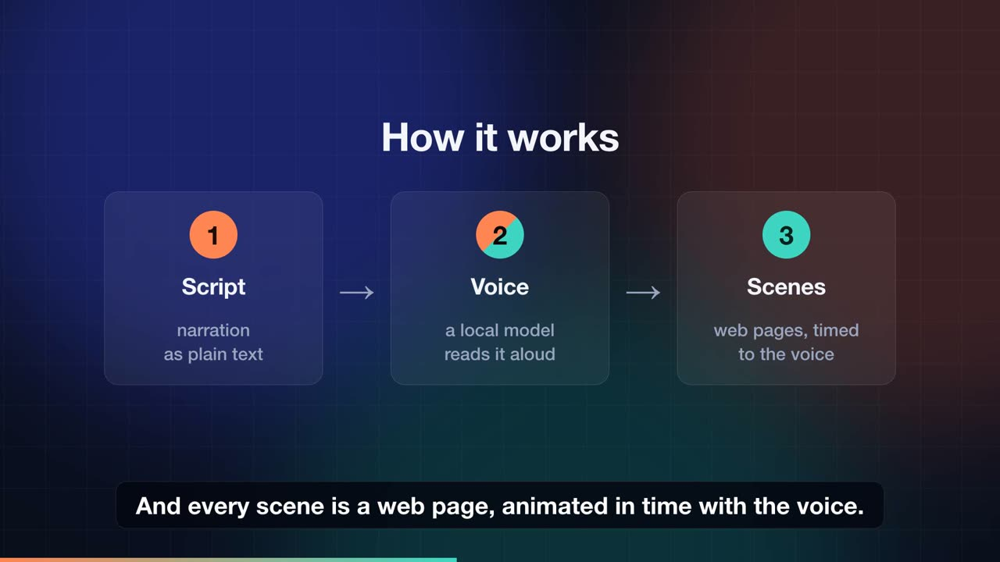

# LinkedIn video toolkit

Make a short video about one of your GitHub repositories and post it to LinkedIn, with one command, on Windows, macOS or Linux.

```sh
python run.py
```

That command:

1. installs what it needs, the first time;
2. checks, in your default browser, that you are signed in to **GitHub** and **LinkedIn**. If you are not, it shows the sign-in page and waits for you;
3. lists your GitHub repositories and asks which one the post is about;
4. makes a narrated video and a post text from that repository's description, README, languages and stars;
5. shows you both, and publishes only when you answer **yes**.



The voice is a speech model that runs on your own computer. The music and sound effects are generated by the code. No AI service and no API key are involved: the wording comes from the repository itself. Nothing is uploaded anywhere except the post you choose to publish.

The parts also work on their own:

| What | Command | Result |
|---|---|---|
| Post about one of your repositories | `python run.py` | one LinkedIn post on your profile |
| Build a narrated explainer video from your own script | `python video/build.py example` | `out/example.mp4` |
| Record a real web app being used | `tools/record.py`, `tools/demo_example.py` | an MP4 screen recording |
| Post a video and text you already have | `python run.py --post video.mp4 post.txt` | one LinkedIn post on your profile |

## What you need

- Windows, macOS or Linux.
- A browser. It uses your default one: Safari on a Mac, or Chrome, Edge, Firefox or another Chromium-based browser (Brave, Vivaldi, Opera, Arc) on any system. See [Which browser](#which-browser).
- [Google Chrome](https://www.google.com/chrome/) or Microsoft Edge for making the video frames. If neither is installed, a copy of Chromium is downloaded for that.
- [uv](https://docs.astral.sh/uv/) (recommended), or Python 3.12 or newer.
- About 1.5 GB of free disk space.

Developed and tested on macOS with Safari. The Chrome, Edge and Firefox path and Windows and Linux have had less testing, so run `python run.py --dry-run` first there and please report what breaks.

## Setup

### 1. Get it and run it

```sh
git clone https://github.com/<your-username>/<this-repo>.git
cd <this-repo>
python run.py
```

On Windows, `py run.py` works as well. If your Python is older than 3.12, install uv and run `uv run run.py`.

The first run creates a Python environment in `.venv/` and downloads the [Kokoro](https://github.com/thewh1teagle/kokoro-onnx) voice model (about 350 MB) into `video/tts/`. To do only that, run `python run.py --setup`.

### 2. Sign in

`run.py` works in your **default browser**. What that means depends on the browser.

**Safari (macOS).** It uses the Safari you already use. If you are signed in to GitHub and LinkedIn there, there is nothing to do. If not, it opens the sign-in page in a new tab and waits. Two permissions are needed, once:

- macOS asks whether the app you run commands from (Terminal, iTerm, VS Code, ...) may control **Safari**. Click **Allow**.
- For posting, switch that same app on under **System Settings → Privacy & Security → Accessibility**. Posting presses Safari's buttons through macOS Accessibility, so macOS must be in English too, and you must keep your hands off the keyboard and mouse while it posts.

Pages are opened in a background tab, read, and closed again. Nothing is injected into them.

**Chrome, Edge, Firefox and others.** These browsers do not let a program drive your everyday profile, so `run.py` opens a window of the same browser with **its own profile**, kept in `.browser/` in this folder. The first time, nobody is signed in there:

1. The window shows the GitHub sign-in page. Sign in the normal way, including any two-step verification.
2. The window then shows the LinkedIn sign-in page. Do the same.

The terminal says `Waiting...` while you do this and carries on by itself when you are in. The next time you run it, you are still signed in. `.browser/` is ignored by git; to sign out of everything, close the window and delete that folder. If "Sign in with Google" is refused in that window, sign in with your email and password instead.

**In every browser:** the toolkit has no login of its own. It never asks for your password in the terminal and does not read passwords, cookies or tokens. LinkedIn's display language must be **English** (LinkedIn settings, under Account preferences), because the buttons are found by their labels ("Start a post", "Add media", "Next", "Post").

### Which browser

Your default browser is used. To use another one:

```sh
python run.py --browser safari
python run.py --browser edge
python run.py --browser firefox
python run.py --browser "C:\Program Files\BraveSoftware\Brave-Browser\Application\brave.exe"
```

If the default browser cannot be started, it falls back to one you used here before, then Chrome, then Edge. Chrome and Edge are used as installed. `firefox` and `chromium` are downloaded on first use (they are the builds made for browser automation, not the one you may have installed). Each of these has its own profile, so you sign in once per browser.

## Using it

### Post about one of your repositories

```sh
python run.py
```

```
Checking your sign-ins...
GitHub: signed in as ada
LinkedIn: signed in

Your repositories on GitHub, most recently updated first:
    1  weather-cli   [Python]           A tiny weather report for the terminal
    2  notes-app     [TypeScript, private]
    3  dotfiles      [Shell]

Which one do you want to post about? Type its number, or owner/name:
```

Type a number. You can also type `owner/name` for a repository that is not in the list, such as one of an organisation.

After about a minute you get `out/repo-<name>.mp4` and `out/repo-<name>.txt`. The video opens, the text is printed, and you are asked whether to publish. **To change the wording, edit the text file and save it before you answer.** Answer `yes` to publish; anything else stops without publishing.

Useful variations:

```sh
python run.py --no-post              # make the video and the text, publish nothing
python run.py --dry-run              # fill in the LinkedIn post, but stop before pressing Post
python run.py --repo ada/weather-cli # skip the question
python run.py --list                 # check the sign-ins, list the repositories, stop
python run.py --voice af_heart       # another voice
```

Run `--dry-run` once before your first real post. It shows you the finished post in the browser without publishing it.

What the video says comes from the repository:

| Scene | Taken from |
|---|---|
| The name and one sentence about it | the repository description, or the first paragraph of the README |
| "What it does", up to three points | the first feature list in the README, or its opening sentences |
| "Built with" | the language breakdown GitHub shows |
| Stars and forks | shown only for a public repository with at least 10 stars |
| Where to find it | the repository address |

So the better the description and README, the better the video. A private repository asks for an extra confirmation first, and its video and text carry no link.

The generated scenes are in `video/build/repo-<name>.html` and the narration in `video/build/repo-<name>_script.json`. To polish a video by hand, edit those and run `python video/build.py repo-<name>`.

### Make your own narrated video

A video has two parts: the narration in `video/script_data.py`, and the scenes in `video/<name>.html`.

1. Open `video/script_data.py` and add an entry to `VIDEOS`, next to `"example"`. Each segment is one scene:

   ```python
   "myvideo": [
       # (scene id, what the voice says, what the caption shows, pause after in seconds)
       ("hook", "Our A.P.I. got three times faster.|Here is how.",
                "Our API got 3x faster.|Here is how.", 0.5),
   ],
   ```

   `|` splits a scene into phrases. The spoken text and the caption text must have the same number of phrases. Spell things out in the spoken text when the voice would stumble ("A.P.I.", "three times"), and write them normally in the caption.

2. Copy `video/example.html` to `video/myvideo.html`. Make one `<section class="scene" id="s-hook">` for each scene id, and change the last line to load `build/myvideo_timeline.js`. The comment at the top of `example.html` lists the animation attributes (`data-at`, `data-fx`, `data-count`, `data-bar`, `data-type`).

3. Build it:

   ```sh
   python video/build.py myvideo                  # -> out/myvideo.mp4
   python video/build.py myvideo af_heart 1.05    # another voice, slightly faster
   ```

   Use the Python of the environment: `.venv/bin/python` on macOS and Linux, `.venv\Scripts\python` on Windows. On macOS and Linux, `video/build.sh myvideo` does the same.

While you are designing, you do not have to build the whole video each time:

```sh
cd video
../.venv/bin/python tts.py myvideo             # voice and timing (needed once, and after script changes)
../.venv/bin/python render.py myvideo 3 12.5   # still frames at 3 s and 12.5 s -> build/preview/
```

Good to know:

- Build one video at a time. Two builds of the same video running together write the same files and can leave a broken MP4.
- The frame is 1920×1080. For another size, add `<meta name="video-size" content="1080x1350">` to the page's `<head>` and write your own CSS for it. `style.css` is laid out for 1920×1080.
- Sound effects and the music's chords are optional and set per video in `CUES` and `MUSIC` in `script_data.py`.
- Voices are the Kokoro voices, for example `am_michael`, `af_heart`, `bf_emma`.

### Record a real web app

```sh
.venv/bin/python tools/record.py https://example.com out/site.mp4 10      # record a page for 10 seconds
.venv/bin/python tools/demo_example.py https://example.com out/tour.mp4   # scripted scroll through a page
```

`tools/demo_example.py` is a template. Copy it and replace the marked section with the clicks and typing that show your own app. It can pause the recording during a long wait and block a request that would have a side effect, such as sending an email.

The recording is silent, 1280×720, made in a hidden Chrome window, so this part needs Google Chrome. For an app that runs on your machine, start it first and record its `http://localhost:...` address.

### Post a video you already have

1. Write the post text in a plain text file, for example `out/post.txt`. Read it carefully. This is exactly what will be published.
2. Run:

   ```sh
   python run.py --post out/myvideo.mp4 out/post.txt
   ```

This one does **not** ask "are you sure?": it publishes straight away. Add `--dry-run` to stop before the last button.

What posting does, here and in the main flow: opens your feed, presses **Start a post**, attaches the video, puts in the text, compares what is in the editor with your text, and only then presses **Post**. If the text does not match, it stops without posting. Leave the browser alone until it finishes, usually one to three minutes. In Safari, do not touch the keyboard or mouse at all: it types into whatever window is in front, and it replaces your clipboard with the post text.

| Output | Meaning | What to do |
|---|---|---|
| `POSTED` | The post is live. | Nothing. |
| `NO START BUTTON`, `NO MEDIA BUTTON`, `FILE DIALOG STUCK`, `VIDEO NOT ATTACHED`, `NO EDITOR`, `TEXT MISMATCH`, `NO POST BUTTON`, `NO MATCH`, `NO ACCESSIBILITY` | A step failed. Nothing was posted. | Close the half-finished post in the browser, fix the cause (see Troubleshooting) and run it again. |
| `LIMIT REACHED` | LinkedIn says you have hit its posting limit. | Wait until tomorrow. |
| `NO CONFIRMATION` | **Post** was pressed, but no "Post successful" message was seen. | Look at your profile before you run it again, or you may post twice. |

### The Safari scripts on their own (macOS only)

With Safari, `run.py` posts through `tools/post.sh`. You can also call it directly, with a signed-in LinkedIn tab open in the front Safari window:

```sh
tools/post.sh out/myvideo.mp4 out/post.txt
```

`tools/ghraw.sh <owner>/<repo> <path> <dest-file> [branch]` saves one file of a private repository through the same Safari session.

## Rules

These are for your own protection. Please follow them.

1. **Post only from your own account**, signed in by you. Never ask anyone for their LinkedIn or GitHub password, and never type yours into anything except the real LinkedIn and GitHub sign-in pages in a browser window.
2. **You are responsible for what is posted.** Watch the video and read the text before you answer yes. The wording is assembled automatically from the repository and can be wrong, clumsy or out of date.
3. **One post at a time, at a human pace.** Do not put this in a loop or on a schedule. LinkedIn's User Agreement restricts automated activity, and an account that looks like a bot can be limited. Read the agreement and decide for yourself. You use this at your own risk.
4. **Do not use the browser while it is posting.** With Safari, do not touch the computer at all, and close anything sensitive first: it types into the window in front and replaces your clipboard.
5. **Only show what you are allowed to show.** A post about a private repository publishes its name, description and README lines. No one else's private data, no customer information, no pages behind someone else's login. Use made-up data in demos.
6. **Do not present a simulation as the real thing.** If a video is an animation or a re-enactment rather than a recording, say so in the post.
7. **Keep private things out of git.** Your videos and post texts (`out/`), cloned projects (`repos/`), build files and the browser profile with your sign-ins (`.browser/`) are ignored by `.gitignore`. Leave it that way, and never commit passwords, tokens or `.env` files.

## Troubleshooting

| Problem | Cause and fix |
|---|---|
| `Could not start a browser` | A window from an earlier run is still open: close it. Or the browser is not installed: pass `--browser` with one that is. |
| `macOS did not let this app control Safari` | Open System Settings → Privacy & Security → Automation and switch on Safari for the app you run this from. |
| `NO ACCESSIBILITY` | Posting through Safari needs the app you run this from switched on under System Settings → Privacy & Security → Accessibility. |
| `NO MATCH` while posting through Safari | A button was not found. The Safari window must be on the visible screen, not minimized, with LinkedIn and macOS in English. `.venv/bin/python tools/ax.py find "post"` lists what the page exposes. |
| `FILE DIALOG STUCK` in Safari | The video path was not typed correctly into the file dialog. Use a keyboard layout that types plain English characters (US or ABC). |
| It keeps saying `Waiting...` after you signed in | Finish every step of the sign-in (verification code, "remember this browser"). For LinkedIn, it continues when the window shows your feed. |
| `NO START BUTTON` | LinkedIn is not in English, or you are signed out. Check the browser. |
| `VIDEO NOT ATTACHED` | The upload did not finish within three minutes. Try a smaller file or a better connection. |
| `TEXT MISMATCH` | LinkedIn changed the text while it was typed, often an emoji or an unusual character. The difference is printed. Simplify those characters in the text file. |
| A step fails after LinkedIn changed its pages | The buttons are found by their labels. Run `python run.py --dry-run` to see where it stops; nothing is published by a step that fails. |
| The list of repositories is empty or short | The list shows your own repositories, 150 at most. Type `owner/name` for any other one. |
| The video says little | The repository has no description and no README text to draw from. Add them, or write the video by hand (see "Make your own narrated video"). |
| The voice mispronounces a word | Edit the spoken text in `video/build/repo-<name>_script.json` (second item of a segment) and rebuild: spell it the way it sounds ("Kwen" for Qwen, "engine X" for nginx). The caption keeps the correct spelling. |
| Rendering fails to start | No Chrome or Edge was found and the download of Chromium failed. Install Chrome. |

## What is in the repository

```
run.py                 the one command: setup, sign-in checks, pick a repository, video, post
requirements.txt       Python packages
toolkit/
  browser.py           find your default browser; Chrome, Edge, Firefox ... with their own profile
  safari.py            the real Safari on macOS, through AppleScript
  github.py dom.py     is GitHub signed in, list repositories, read one repository
  story.py             repository facts -> narration, scenes and post text (no network, no AI)
  linkedin.py          is LinkedIn signed in, publish one post
video/
  build.py             script -> voice -> frames -> music -> out/<name>.mp4  (build.sh calls it)
  script_data.py       the narration, sound cues and music choice for hand-written videos
  example.html         the scenes of the example video
  engine.js style.css  the animation engine and the look shared by all videos
  tts.py render.py mix.py    the three build steps
tools/
  record.py            record a web page to MP4 (also a library: Recorder, launch)
  demo_example.py      template for a scripted walkthrough of a web app
  demo_common.py       smooth scrolling for walkthroughs
  post.sh ax.py fill.py diff.py submit.py click.py ghraw.sh    posting through Safari (macOS only)
tests/                 python -m unittest discover tests   (with the .venv Python)
setup.sh               the same as: python run.py --setup
```

Created on your machine and ignored by git: `.venv/`, `.browser/`, `video/tts/`, `video/build/`, `out/`, `repos/`.

## Licence

MIT. See [LICENSE](LICENSE). The Kokoro voice model downloaded by `setup` has its own licence (Apache 2.0).
